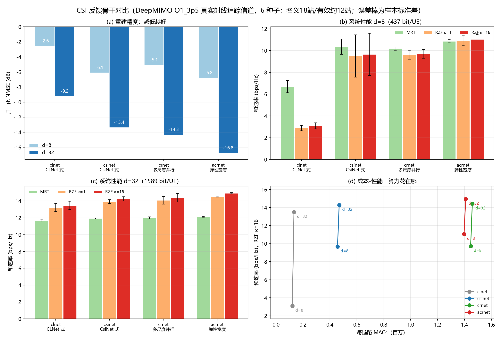
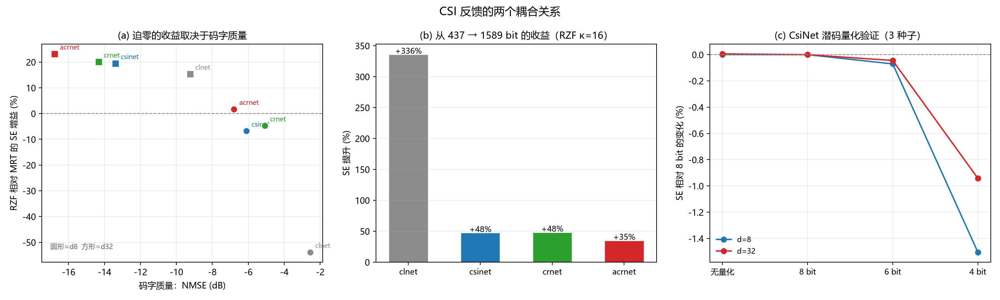
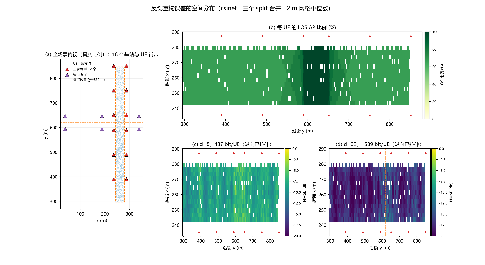

<div align="center">

# AI-UCF-CSI

**CSI 反馈网络在用户中心去蜂窝系统中的移植与评测**

4 种反馈骨干 × 2 档反馈预算 × 6 个训练种子，信道来自 DeepMIMO 射线追踪。
附 AP 分簇、波束成形与功率优化的系统级对比。

`PyTorch` · `DeepMIMO` · `FDD 3.5 GHz` · `MRT / RZF`

</div>

---

## 项目背景

用户中心去蜂窝系统用大量分布式 AP 共同服务每个用户，没有小区边界。FDD 制式下，
每个用户需要回传多条链路的 CSI，反馈精度直接决定预编码能拿到多少相干增益。
因此压缩质量要放到系统链路里衡量，单看重建误差不足以说明问题。

本项目把两层接起来评测：从 CSI 码字出发，经逐 AP 预编码与功率分配，算到频谱效率。
信道使用 DeepMIMO `O1_3p5` 的射线追踪结果，不是独立同分布合成信道。

## 系统与数据

| 项 | 取值 |
| --- | --- |
| 场景 | DeepMIMO O1_3p5，两条街加一个路口，3.5 GHz，18 个 6 m 高基站 |
| 阵列 | 场景每站单天线，用射线到达角合成 4 天线半波长 ULA |
| 系统 | L=18 AP，K=18 用户，Na=4，Nf=32，候选 M=6，服务 S=3 |
| 物理参数 | 带宽 10 MHz，载频 3.5 GHz，每 AP 功率 0.1 W，噪声系数 7 dB |
| 反馈预算 | `M×(d×q+q_p)+⌈log₂C(M,S)⌉`，d=8 时 437 bit，d=32 时 1589 bit |

原始 CSI 每条链路为 2×4×32 个复数，按 float32 计 8192 bit，437 bit 与 1589 bit
分别对应约 1/19 与 1/5 的压缩比，不含导频与协议开销。

## CSI 反馈结果

6 个训练种子均值，SE 单位为 bps/Hz（18 用户合计）。

| 骨干 | d=8 MRT | d=8 RZF | d=32 MRT | d=32 RZF | NMSE d=8 / d=32 | MACs/链路 |
| --- | ---: | ---: | ---: | ---: | ---: | ---: |
| CLNet 式 | 6.70 | 3.09 | 11.69 | 13.48 | −2.6 / −9.2 dB | 0.13 M |
| CsiNet 式 | 10.36 | 9.66 | 11.94 | 14.26 | −6.1 / −13.4 dB | 0.47 M |
| 多尺度并行 | 10.20 | 9.71 | 12.01 | 14.41 | −5.1 / −14.3 dB | 1.46 M |
| 弹性宽度 | 10.86 | 11.05 | 12.13 | 14.94 | −6.8 / −16.8 dB | 1.41 M |



弹性宽度结构在两档预算下的平均和速率最高。它在 d=32 相对 CsiNet 式的提升为
MRT +1.6%、RZF +4.7%，六个种子同向，配对 t 检验 p 值约 1.5e−4 与 6.0e−4。
d=8 时领先幅度更大（MRT +4.9%，RZF +14.3%），但只有 4/6 种子同向，不能称显著。
计算代价约 3 倍 MACs，CLNet 式则是最轻量的成本基线。

预编码与码字质量之间存在明显耦合：



CLNet 式在 437 bit 下码字 NMSE 为 −2.6 dB，此时 RZF 比 MRT 低 53.9%；弹性宽度在 1589 bit
下码字达到 −16.8 dB，RZF 比 MRT 高 23.2%。四个骨干与两档预算形成一条单调关系，
经验交叉点在 NMSE −6 dB 附近。弱码字配合迫零是负收益组合。

潜码按 8 bit/维 做对称量化后，结果与 float32 码字一致，6 bit 差异小于 0.1%，4 bit 损失
0.9% 至 1.5%。表中比特数是实际可用的预算，不是名义值。

重建误差的空间分布：



沿街方向变化约 3.5 dB，跨街只有 0.8 dB，最差的一段在路口。路口处 18 个 AP 全部直射，
每条链路更接近秩 1，但到达角偏离 4 点 DFT 的栅格，能量泄漏到相邻系数，稀疏性比普通路段差。
固定维数的码字在路口更容易失效。

## 系统级优化：分簇与波束

分簇与波束使用独立评测批次，脚本未包含在仓库中。主要结论如下，完整表格见
[docs/系统级优化结果.md](docs/系统级优化结果.md)。

**分簇规则**（验证集 200 快照，CsiNet d=32 种子 0）：

| 规则 | MRT 和速率 | MRT p5 | RZF 和速率 | RZF p5 |
| --- | ---: | ---: | ---: | ---: |
| 原固定簇 | 13.09 | 0.353 | 14.06 | 0.054 |
| 负载均衡 | 14.54 | 0.474 | 12.30 | 0.048 |
| 两轮交换 / 统计补偿 | 16.03 | 0.335 | 16.77 | 0.012 |

负载均衡在 MRT 下和速率提高 11.1%、p5 由 0.351 升至 0.475，在 RZF 下和速率下降 12.5%。
规则不能跨预编码照搬。

**联合优化与凸优化参考**（测试集前 50 快照，均与匹配迭代预算比较）：

| 方法 | MRT 和速率 | RZF 和速率 | 相对控制组 | 弱用户 p5 |
| --- | ---: | ---: | ---: | ---: |
| 固定簇 + 复波束 PG240 | 32.70 | 34.19 | 基线 | 0.0696 / 0.0265 |
| 预筛联合优化（对比等预算控制） | 33.96 | 34.93 | +0.85% / +0.16% | 0.0486 / 0.0208 |
| SCA-SOCP（50 快照另批） | 32.23 | 32.03 | 比复波束 +2.1~3.1 | 2.9e-3 / 1.8e-4 |

联合优化的平均增益有限且弱用户变差；SCA 的和速率更高，代价是每快照约 100 秒。
**学习波束**在 150 个快照上，纯网络方案和速率 18.13（p5 0.198），优于固定簇 MRT 与 RZF，
低于迭代优化；"学习初始化 + PG40"组合达到 36.62，是本批次最高值。

## 目录结构

```
ai-ucf-csi/
├── evaluate.py                 评测：恒等自检、码字量化、预编码与功率策略
├── train_codec.py              单次码字训练
├── configs/cf_r18_deepmimo.yaml
├── src/
│   ├── data/adapters/deepmimo_rays.py   射线到 4 天线 ULA 的合成
│   ├── data/dataset.py                  派生数据、门禁与标签
│   ├── models/csi_codec.py              CLNet 式骨干、码字量化
│   ├── models/zoo.py                    CsiNet 式、多尺度、弹性宽度
│   ├── system/precoding.py              MRT 与 RZF（支持集约束）
│   ├── system/power.py                  功率策略
│   └── feedback/quantize.py             功率量化
├── scripts/                    训练批处理、评测矩阵、统计、画图、诊断
├── tests/                      6 个可独立运行的验收自检
└── docs/                       结果、系统级对比、运行方式与图
```

## 复现

```bash
# 数据适配（射线合成 4 天线 ULA）
python src/data/adapters/deepmimo_rays.py --zip deepmimo_scenarios/o1_3p5.zip     --out data/deepmimo_o1_r18 --ap-count 18 --ue-count 18 --candidates 6 --serving 3
python src/data/dataset.py --config configs/cf_r18_deepmimo.yaml     --data-dir data/deepmimo_o1_r18 --build

# 训练与评测
python scripts/train_zoo.py --data-dir data/deepmimo_o1_r18     --archs clnet,csinet,crnet,acrnet --dims 8,32 --seeds 0,1,2,3,4,5
python scripts/zoo_matrix.py --ckpt-root runs --config configs/cf_r18_deepmimo.yaml     --data-dir data/deepmimo_o1_r18 --kappas 1,16
python scripts/zoo_stats.py --csv runs/zoo-matrix/matrix.csv
```

其余命令、参数与诊断脚本见 [docs/复现.md](docs/复现.md)；结果与统计见
[docs/结果与统计.md](docs/结果与统计.md)。

## 结论的边界

1. 单场景。只有 O1 的一条街和一个路口，没有第二场景交叉验证，也不是密集城区。
2. LOS 主导。链路级直射比例 72%，NLOS 密集环境下 RZF 的收益需要重新测量。
3. 名义 18 站，实际有效约 12 站。用户只铺在主街，横街 6 个 AP 在候选集里出现率仅 1.7%。
4. 逐 AP 局部预编码。RZF 只抑制本 AP 内的多用户干扰，不处理簇外干扰，也未做集中式 WMMSE。
5. 功率策略是固定规则，没有与波束联合优化。
6. 六个种子反映训练重复性，不是六个独立场景；多重比较未校正。
7. 4 天线由射线角度合成，阵列姿态取全局坐标轴，真实部署会更复杂。
